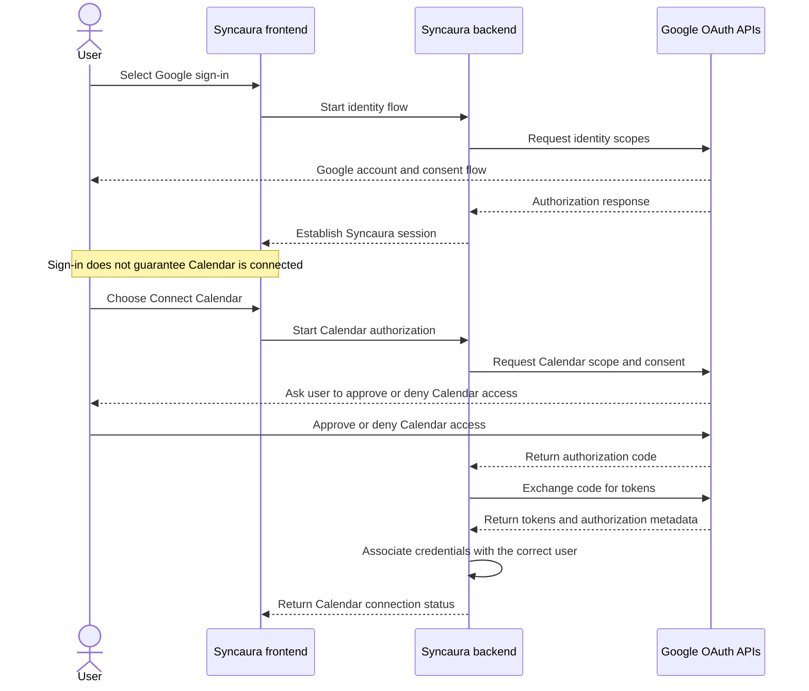

# Syncaura — Backend-Captain Interview Preparation

This document is designed for technical interviews about the Syncaura internship project. It combines the user's reported Google Calendar OAuth challenge with repository-grounded technical questions and explicitly labeled hypothetical practice scenarios.

## Important honesty rule

Only claim work you actually performed, decisions you participated in, results you observed, or metrics you can defend. Interviewers routinely ask follow-ups. A technically plausible story is not a substitute for a true story.

Three labels are used:
- **Reported experience** — based on the user's own description.
- **Repository-grounded discussion** — based on the current source snapshot; it may not describe who personally implemented a file.
- **Hypothetical practice scenario** — an invented problem for technical practice. Use it to explain what you *would do* or as a hypothetical design exercise, not as a past internship achievement unless it is independently true.

## 1. “Tell me about Syncaura.”

### Strong answer framework
“During my internship, I worked on Syncaura, a team collaboration and project-management platform. The application brings workflows such as projects and tasks, attendance/leave, meetings, documents, notifications and communication into one place. I served as backend captain, so my preparation focuses on how the APIs, authentication, data persistence, integrations and asynchronous workflows fit together, as well as how the frontend consumes those capabilities.”

The current source snapshot contains a React/Vite frontend and a Node.js/Express backend. The backend uses PostgreSQL via the `pg` package, has route/controller modules, Socket.IO setup, scheduled reminders and several integration modules. There is also a separate AI-related directory. The backend README appears out of date about the database, so describe PostgreSQL as the current source implementation and mention the documentation discrepancy if relevant.

**Before the interview:** be ready to name the exact backend modules you personally owned, which changes you authored/reviewed, and which team decisions you contributed to. “Backend captain” should be supported by concrete responsibilities, not just the title.

### Likely follow-ups
- Who were the users?
- What workflow was most important?
- Which backend modules did you personally own?
- How was authorization enforced?
- What was persisted in PostgreSQL?
- What was real-time versus request/response?
- Which external integration caused the most difficulty?
- What did you personally deliver?

Answer with one concrete feature and trace its request from frontend to route, middleware, controller, SQL/side effect, and response.

## 2. “What problem does Syncaura solve?”

### Answer
“Teams can end up switching between separate tools for projects, tasks, meetings, attendance/leave, communication and documents. Syncaura aims to bring those workflows under one application with role-aware access and shared data, reducing fragmentation and making collaboration easier to coordinate.”

Do not claim measured productivity gains or adoption improvements unless you have actual evidence. If asked how impact would be measured, propose metrics such as task completion time, number of tools needed for a workflow, response latency, failed reminder rates, and user feedback.

## 3. “What was your role as backend captain?”

### Answer structure
“My responsibility was to understand and coordinate backend behavior across API modules and integrations, help the team make implementation decisions, review cross-module dependencies, and help resolve backend issues. A key example I can explain is the Google Calendar consent-flow problem: sign-in and calendar access were coupled in the user experience, and we discussed separating authentication from the optional calendar authorization step.”

Adapt the answer to your true work. Only state that you reviewed code, assigned tasks, merged pull requests, wrote specific modules, or improved metrics if you actually did those things.

### Follow-up: “What does a backend captain do differently from a developer?”
A developer may focus on an assigned feature. A backend captain should also understand API contracts, shared middleware, database impact, integration boundaries, failure handling, compatibility, code review, and cross-feature coordination. The title does not remove the need to be specific about individual contributions.

## 4. Reported challenge — Google login versus Google Calendar permission

**Basis:** The user reported that calendar permission was required, that Google would not grant the desired access through a simple sign-in step without a separate user consent, and that the team discussed offering calendar access as a separate option after login.

### Interview-ready answer
“One integration challenge was separating identity from calendar access. Signing in with Google answers ‘Who is this user?’; accessing their Google Calendar is a separate authorization decision that requests additional scopes. We did not want calendar access to block the core sign-in experience. The design we discussed was to complete login first and provide a separate option for users to connect their calendar when they wanted that feature. That separates authentication from optional delegated authorization, makes the consent more understandable, and allows users who do not need calendar integration to use the core application.”

This answer accurately describes the design decision the user reported. Before saying it was fully shipped, confirm the implementation and end-to-end result.

### How the two flows differ

This is the **target design** for explaining separation of concerns. The actual source includes Google authentication/calendar code, but exact endpoint behavior, token persistence, state handling and whether this precise UX is fully implemented must be verified before claiming every step matches production.

### Follow-up: “Why not request every scope during login?”
Because login and calendar access serve different purposes. Requesting unnecessary scopes can surprise users, increase consent friction, and make sign-in depend on a feature they may never use. Separate authorization lets the app request the minimum scope needed at the point when the feature is used.

### Follow-up: “Is Google always blocking Calendar access during sign-in?”
Do not phrase it as a universal Google prohibition. OAuth supports requesting scopes during an authorization flow, but the consent shown and access granted depend on the scopes, app configuration, account type, existing grants and applicable Google policies. The engineering principle here is to separate application authentication from optional access to the user's data—not that Google can never request Calendar consent during login.

### Follow-up: “What is the authorization-code flow?”
1. The application redirects the browser to the provider with client ID, redirect URI, scopes, state and other parameters appropriate to the flow.
2. The provider authenticates/asks consent and redirects back with a short-lived authorization code.
3. The backend validates the callback/state and exchanges the code for tokens.
4. The application uses an access token for the allowed API scope; refresh tokens, when issued and properly stored, can obtain new access tokens.
5. The application handles revocation, expiration, provider errors and disconnect.

The exact parameters depend on whether this is a server-side web OAuth client or a public client. Do not expose a client secret in frontend code.

### Follow-up: “What is the difference between authentication and authorization?”
- **Authentication:** establishes the user's identity.
- **Authorization:** determines which resources/actions that identity may access.
- **OAuth delegated authorization:** gives an application specific permission to act against a provider API on a user's behalf.
- **Application authorization:** for example, whether a Syncaura user has the role/ownership needed to edit a project.

Google login can identify a user without giving the application Calendar access. A calendar scope does not by itself determine what the user can do inside Syncaura.

### Follow-up: “What would you test?”
- A user can complete core login without connecting Calendar.
- Calendar connection can be started later from settings or the feature entry point.
- Denying Calendar consent does not destroy a valid core session.
- A successful callback binds the provider account to the correct Syncaura user.
- State/CSRF protections and redirect URI validation work.
- Missing, expired or revoked grants produce a recoverable connection state.
- Calendar API errors and quota/rate-limit responses are handled clearly.
- Tokens are not logged or exposed to the frontend unnecessarily.
- Disconnect removes/revokes credentials as appropriate and stops future API use.

### Security details to understand
- Request the minimum necessary scopes.
- Validate `state` on OAuth callbacks to protect the authorization flow against CSRF.
- Use exact registered redirect URIs.
- Protect client secrets on the backend.
- Encrypt or otherwise appropriately protect stored tokens; never log token contents.
- Use refresh tokens only when needed and handle revocation.
- Avoid treating a successful third-party login as proof that the user is authorized for arbitrary Syncaura resources.

### What still needs confirmation from implementation
- Which exact Google scopes are used for sign-in and Calendar connection?
- Does login create/refresh the Syncaura session before calendar connection?
- Where are access/refresh tokens persisted and how are they protected?
- What are the exact consent/connect/disconnect UI routes?
- How are denied consent, revocation and token expiry handled?

## 5. Common backend technical questions

### Q: Explain the lifecycle of an API request.
**Answer:** “The frontend sends an HTTP request through its Axios client. Express runs registered middleware in order, matches a route, executes authentication/authorization and validation where configured, invokes the controller, performs database or external-service operations, and returns a status code and JSON response. Shared error middleware handles propagated failures. For a specific endpoint I would trace the exact mounted path, its middleware, controller, SQL and response.”

Follow-up: why does middleware order matter? Because parsing, authentication, request validation, logging, route execution and error handling depend on being registered at the right point in the chain.

### Q: What is the difference between a route and a controller?
**Answer:** “A route defines the HTTP method/path and wires middleware to a handler. A controller handles the request/response boundary and commonly coordinates the required business operation. The important thing is not the file name; it is whether request parsing, business logic and persistence are cleanly separated and whether authorization is enforced at the correct boundary.”

### Q: Why PostgreSQL? Why relational data?
**Answer:** “Syncaura has relationships between users, projects, tasks, members, meetings and other entities. PostgreSQL provides relational constraints, joins and transactions that help maintain consistency. We should select indexes and queries around actual access patterns and use transactions when a business operation must succeed or fail as one unit.”

Follow-up: when would a transaction be useful? For example, when multiple related database writes form one logical operation. Calls to an external API cannot generally be rolled back just because a database transaction rolls back, so integrations need additional coordination/idempotency.

### Q: What is a connection pool?
**Answer:** “A pool maintains a bounded set of reusable database connections instead of opening a new connection for every query. It reduces connection setup cost and controls concurrency. The pool needs an appropriate maximum, query timeouts and lifecycle handling; too much concurrency can overload the database rather than make it faster.”

### Q: How would you find a slow endpoint?
**Answer:** “I would first measure end-to-end latency, then separate time spent in middleware, SQL, external calls and serialization. I would add request correlation and timing logs, inspect the SQL query plan with representative data, and reproduce under realistic load. I would avoid adding a cache before understanding whether the bottleneck is query shape, missing indexes, an external call, or excessive work.”

### Q: When would you use an index?
**Answer:** “When query plans and workload evidence show repeated filters, joins or sort patterns that benefit from indexing. Indexes can reduce reads, but add write cost and storage. I would compare execution plans and timings before/after and avoid creating an index for every column.”

### Q: Where might Redis help?
**Answer:** “Redis can support shared rate-limit counters, short-lived cached reads, distributed coordination or a queue backend. I would introduce it only after finding a use case where its latency or coordination benefits justify the additional dependency. A cache needs a defined key, TTL and invalidation strategy; sensitive user data must not leak across user or tenant boundaries.”

### Q: What is the difference between caching and a job queue?
**Answer:** “Caching stores a reusable result to avoid repeating expensive work. A queue stores work to be executed asynchronously by workers. They solve different problems even if both use Redis as infrastructure.”

### Q: What makes a background job reliable?
**Answer:** “The job should have an explicit schedule or trigger, durable input, bounded retries, observable success/failure, idempotent effects and safe handling of overlapping executions. Retrying a job without idempotency can send duplicate emails or create duplicate calendar events.”

### Q: What are idempotency and retries?
**Answer:** “An operation is idempotent if repeating it produces the same intended state as running it once. Retries are useful for transient failures such as timeouts or rate limits, but the retry policy must be bounded and account for whether the first attempt might have succeeded remotely even though the response was lost.”

### Q: How would you secure a REST API?
**Answer:** “Validate request data, authenticate identity, authorize each action against role and resource ownership, use safe SQL parameterization, apply appropriate rate limits, protect session/token handling, restrict CORS to intended origins, enforce upload limits, keep secrets out of logs, and return non-sensitive error messages. Tests should verify both allowed and denied access.”

### Q: What does CORS do?
**Answer:** “CORS is a browser mechanism controlling whether frontend JavaScript from one origin may read a cross-origin response. It is not authentication and does not prevent non-browser clients from calling an exposed API. Authorization must still be enforced on the server.”

### Q: How would you test backend behavior?
**Answer:** “Unit-test deterministic business functions, integration-test routes and database behavior, and use end-to-end smoke tests for critical workflows such as login and calendar connection. Tests should include success paths, invalid input, unauthorized access, missing records, provider failure, and database unavailability.”

### Q: What does CI startup success prove?
**Answer:** “It proves only what the check actually validates. A process that starts and stays alive briefly may still have broken routes, failed asynchronous initialization, incorrect authorization, or untested features. CI should have deterministic tests and readiness checks rather than treating ‘did not exit within a timeout’ as full correctness.”

## 6. Hypothetical practice scenarios — not claims about what happened

Use these to practice deep technical follow-ups. They are deliberately labeled hypothetical. Do not turn them into past-tense stories about the internship unless you independently confirm that they occurred.

### Scenario A: Duplicate reminders

**Hypothetical problem:** Two instances run the same reminder scheduler and send a user two emails for the same task.

**Would-be approach:** Determine deployment topology and job trigger behavior. Give each reminder a stable logical key, such as `task_id + reminder_type + scheduled_for`, and enforce deduplication in durable storage with a unique constraint or a reliable atomic claim. A queue can help separate execution, but a queue alone does not guarantee exactly-once external effects. Make sending observable and decide how failed jobs are retried.

**Follow-ups:**
- Why not rely on an in-memory flag? It disappears at process restart and is not shared between instances.
- Why a database unique constraint? It can make competing claims atomic at the durable data layer.
- Is exactly-once email delivery guaranteed? Generally not end-to-end; use idempotency where provider APIs support it and design for duplicates/ambiguous outcomes.

### Scenario B: Slow dashboard queries

**Hypothetical problem:** A dashboard loads several independent statistics through repeated unindexed queries.

**Would-be approach:** Measure each query, inspect query plans, add the smallest useful indexes, consolidate redundant reads where appropriate, and paginate large result sets. Cache only expensive, frequently reused results with a suitable TTL and invalidation rule. Compare p50/p95 latency and database load against a baseline.

**Follow-ups:**
- What is an N+1 query problem? It is a pattern where one query fetches a collection and a further query is run for each item, causing query count to grow with collection size.
- Why not cache everything? Invalidation and stale data become difficult; it may not improve inexpensive queries.
- What metrics prove improvement? Query duration, rows scanned, p95 endpoint latency, request volume and database utilization.

### Scenario C: External API timeout

**Hypothetical problem:** Google Calendar or Microsoft Graph is slow, causing user-facing requests to hang.

**Would-be approach:** Use explicit connection/request timeouts, classify transient versus permanent errors, apply bounded backoff for retryable failures, and avoid retrying operations that could create duplicate side effects without an idempotency strategy. Consider moving long-running sync to a worker and expose a sync status to the user.

**Follow-ups:**
- Why not retry every error? Invalid credentials or invalid requests will not be fixed by retrying; retries can amplify outages.
- What is exponential backoff? Increasing wait intervals between retry attempts, often with jitter to avoid synchronized retry storms.
- When would a circuit breaker help? When repeated failures to a dependency should temporarily prevent calls and allow recovery instead of continually exhausting resources.

### Scenario D: File upload consumes too much storage

**Hypothetical problem:** Users upload large files and the deployment's local disk fills up or loses files on redeploy.

**Would-be approach:** Enforce request and file-type/size limits, validate content rather than trusting filenames, protect access, and understand storage persistence. If the deployment needs durable scalable file storage, move binary objects to object storage and keep metadata/ownership in PostgreSQL.

**Follow-ups:**
- Should the database store the entire file? It can for some systems, but object storage plus metadata is often more practical for larger binaries.
- Is file extension validation enough? No. Validate MIME/signature as appropriate, scan where needed, use generated storage names, and avoid trusting user-supplied paths.

### Scenario E: Refresh-token race

**Hypothetical problem:** Several requests receive unauthorized responses and simultaneously attempt to refresh the same session.

**Would-be approach:** Coordinate refresh work, prevent infinite retry loops, make token rotation semantics explicit, and handle invalid/revoked sessions safely. If multiple frontend requests are already handled by a single-flight queue, test it thoroughly; if multiple server instances are involved, determine whether server-side coordination is needed.

**Follow-ups:**
- Why can refresh-token rotation race? One request may consume/rotate the token while another uses the previous token.
- Does a browser promise queue coordinate separate devices? No. It coordinates only requests within that frontend JavaScript context.

## 7. STAR-style answer template for real internship challenges

Use this template when you have confirmed the event actually happened:

- **Situation:** What feature or user workflow was blocked?
- **Task:** What were you personally responsible for?
- **Action:** What evidence did you gather, which options did you consider, and why did you choose one?
- **Result:** What changed, how did you verify it, and what limitation remained?
- **Learning:** What would you do differently now?

For the reported Google Calendar challenge:
- Situation: calendar access was needed, but making it part of the core sign-in experience created consent and coupling concerns.
- Task: help reason about an appropriate login/integration experience (state your exact personal role truthfully).
- Action: separate the core identity flow from the optional Calendar authorization flow.
- Result: state only what you verified—e.g., the agreed design, implementation status, or tested behavior.
- Learning: scope should match user intent; identity and delegated access to external data are distinct concerns.

Avoid inventing time saved, conversion improvements, bug counts, user scale, or production outcomes. If there was no numerical measurement, a qualitative outcome is better than a fabricated metric.

## 8. Personal proof checklist

Before an interview, fill in these facts from your actual internship:
- Exact dates and team context.
- The backend features you personally implemented or reviewed.
- Your exact responsibilities as backend captain.
- A concrete pull request/commit or code area you can explain.
- How the Calendar-connect option was actually implemented and tested, if it was.
- One genuine debugging episode besides OAuth, if available.
- A real trade-off your team considered.
- A limitation or mistake and what you learned from it.
- Any real metrics; otherwise, prepare to explain how you would measure them.

## 9. Practice drill

Try answering aloud in 60–90 seconds, then handle three layers of follow-up:
1. **What happened?** Clear user/problem framing.
2. **Why this design?** Explain alternatives and trade-offs.
3. **How do you know it worked?** Explain test evidence, observable behavior and remaining risks.

A credible answer is specific, technically correct, and honest about personal contribution.
