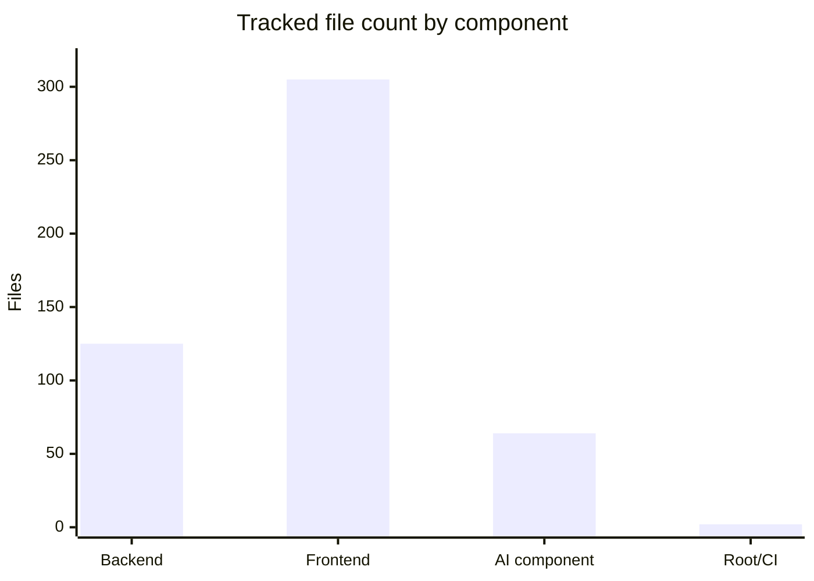
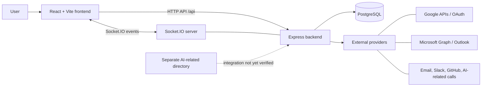
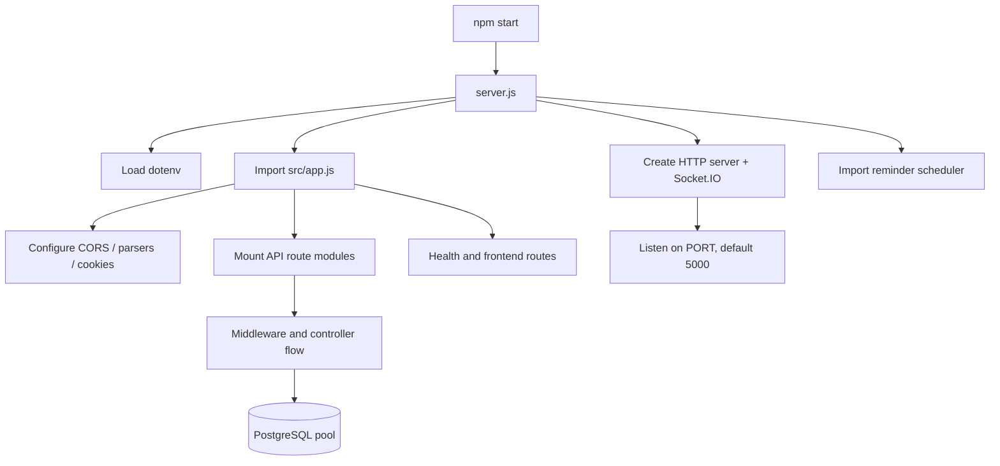

# Phase 1 — Repository Reconnaissance and Architecture

**Status:** Complete for initial reconnaissance; detailed implementation tracing continues in later phases.  
**Source:** [Uptoskillssyncaura/Syncaura-main](https://github.com/Uptoskillssyncaura/Syncaura-main), default branch `main`.  
**Primary focus:** backend; frontend and AI components are included where they define integration boundaries.

## 1. Objective

Build an evidence-based map of Syncaura before reading every backend feature. This phase answers:
- What are the main repository components?
- Which technology and data-store choices are visible in source?
- Which file starts the primary backend?
- How does the frontend reach the API?
- Which architectural mismatches should be investigated early?
- In what order should the backend be analyzed?

This is not yet a complete security or runtime audit. The repository code is inspected statically; behavior that requires a running environment is marked for verification.

## 2. Repository inventory

The Git tree snapshot contains **496 tracked files** in total:

| Component | Tracked files | Observed purpose |
|---|---:|---|
| `Syncaura-backend/` | 125 | Node.js/Express API, PostgreSQL access, application workflows, socket events, scheduler, integrations, static uploads |
| `Syncaura-frontend/` | 305 | React/Vite frontend, pages/components, Redux state, API configuration, frontend documentation |
| `SYNCAURA-AI-PART-/` | 64 | AI-related source tree; one substantive note-taking/audio-analysis service is present |
| Root / `.github/` | 2 | Root ignore file and backend CI workflow |

The backend contains 99 tracked files beneath `src/`, plus root files, an Outlook subproject, public uploads, and package metadata. Its key source areas include routes, controllers, models, middleware, configuration, services, utilities, validators, and schedulers.

### Inventory chart

This chart represents file counts only. It does not measure implementation quality, test coverage, code complexity, or the number of working features.

## 3. System context diagram

### How to read it

- **React/Vite** renders the client application and issues API calls.
- **Express** mounts feature-specific route modules and handles application requests.
- **PostgreSQL** is the database technology shown by the active backend connection and SQL schema files.
- **Socket.IO** is attached to the HTTP server and is intended for real-time interactions.
- **External providers** are integration candidates based on dependencies and service files. Each specific data flow still needs verification.
- The dashed AI edge is deliberately labeled as unverified: a separate source directory does not prove that the main backend invokes it at runtime.

## 4. Main backend startup and request flow

The backend package scripts say:
- `npm start` executes `node server.js`.
- `npm run dev` executes `node --watch server.js`.
- `npm run migrate` executes `node run-init.js`.

Although `package.json` lists `index.js` as its `main` field, the `start` script explicitly selects `server.js`. The `main` field does not override that script.

The exact timing and readiness of database initialization is a Phase 2 question: the diagram intentionally does not imply that PostgreSQL migrations block the server from listening.

## 5. Backend structure and analysis order

| Path | Initial responsibility inferred from name and imports | Planned deep dive |
|---|---|---|
| `package.json` / `package-lock.json` | Scripts and dependency graph | Runtime scripts, dependency inventory, version and test implications |
| `server.js` | Main HTTP and Socket.IO startup | Initialization order, scheduler import, listen behavior, shutdown |
| `src/app.js` | Express middleware and route registration | Middleware ordering, CORS, route contract, static hosting, errors |
| `src/config/db.js` | PostgreSQL connection pool and startup SQL changes | Configuration, connection errors, schema readiness, pool lifecycle |
| `src/config/init.sql` | SQL schema definitions | Entities, foreign keys, constraints, indexes, data integrity |
| `run-init.js` | Explicit schema-initialization script | Env variable mapping, error behavior, process lifecycle |
| `src/routes/` | API endpoint definitions | Endpoint catalogue and route → middleware → controller map |
| `src/controllers/` | Feature request handlers | Input/output, SQL operations, permissions, side effects |
| `src/middlewares/` | Cross-cutting request checks | Identity, role checks, errors, file-upload boundaries |
| `src/models/` | Data/model helpers | Determine whether all are used, since active data access appears PostgreSQL-based |
| `src/services/` and `src/utils/` | Integrations and shared logic | API calls, token storage, email, notification logic |
| `src/scheduler/` | Scheduled reminders/tasks | Job schedule, duplicate processing, error/retry strategy |
| `outlook-sync/` | Separate Microsoft/Outlook experiment or service | Module system, auth/token lifecycle, security, whether actively deployed |
| `public/uploads/` | Uploaded files served by the backend | File validation, storage durability, access control, file size |
| `SYNCAURA-AI-PART-/` | Separate AI-related code | Determine implemented modules and actual integration points |

The file inventory and naming are a starting point; import traces determine the real dependency graph.

## 6. Main observed discrepancies and investigation questions

| ID | Evidence / observation | Why it matters | Next validation |
|---|---|---|---|
| R1 | Backend README describes MongoDB/Mongoose; `src/config/db.js` imports `pg` and `init.sql` contains PostgreSQL DDL | Documentation may direct contributors toward the wrong data-store mental model | Compare all active DB call sites and all model files to establish the actual persistence path |
| R2 | `server.js` is selected by `npm start`; `index.js` independently constructs an Express server and listens on port 3000 | It may be a separate example/legacy flow, not the main API | Search imports, deploy scripts and route overlap; determine intended use |
| R3 | `db.js` creates a PostgreSQL pool from `DATABASE_URL` and performs schema changes on import; `run-init.js` reads separate `DB_HOST/DB_NAME/DB_USER/DB_PASSWORD` values | Runtime and migration configuration can diverge | Test each path with the documented environment and check readiness/error propagation |
| R4 | Both `.env.example` and `env.example` exist and differ, including OAuth/database options and some token-expiration values | Developers may choose different, misleading templates | Identify which environment keys are read and normalize documentation later |
| R5 | `outlook-sync/package.json` declares `type: module`, while its JavaScript files use CommonJS `require/module.exports` | Module loading could fail under the declared Node module semantics | Run the subproject in its intended runtime; inspect whether it is currently used |
| R6 | AI subtree has 64 tracked files, 52 with zero byte size in the source snapshot | Directory layout may overstate implemented API breadth | Inspect import/deployment references and identify which AI scripts are runnable |
| R7 | Backend `npm test` is a placeholder that exits with error; CI runs `npm start` under a 15-second timeout | Current CI primarily attempts startup; it does not establish feature correctness | Inspect CI logs/results, readiness behavior and add deterministic unit/integration tests in a later phase |
| R8 | Redis is listed as a direct backend dependency | A dependency alone does not establish whether Redis is connected or used | Search imports/call sites and assess justified caching/queue/rate-limit use cases |

## 7. High-level technology inventory

**Verified in manifests or imports:**
- Runtime/backend: Node.js with ES-module syntax, Express 5, PostgreSQL via `pg`, Socket.IO, JWT, bcrypt libraries, Express Validator.
- Background work: `node-cron` and scheduler files.
- Integrations/dependencies: Google APIs, Nodemailer, Slack Bolt, Axios, Redis client package, PDF/Excel generation libraries.
- Frontend: React, Vite, Redux Toolkit, React Router, Axios, Socket.IO client, Tailwind CSS, chart libraries.
- AI area: Python/FastAPI and a note-taking service that imports Whisper and joblib-loaded classifier/vectorizer artifacts. This area needs its own runtime/dependency check.

The listed dependencies do not prove that every library is used in production. Phase 7 and Phase 10 will inspect actual call sites before proposing changes.

## 8. Optimization candidates — not decisions yet

| Candidate | Evidence required before implementation | Potential direction |
|---|---|---|
| Query tuning and indexes | Identify slow/repeated SQL and use query plans against representative data | Query rewrite and narrowly targeted indexes |
| Redis cache | Demonstrate repeated expensive reads, acceptable staleness, and a clear invalidation rule | Cache selected read models; measure hit rate and latency |
| Background worker/queue | Measure slow external actions or find reliability problems in request-bound jobs | Queue plus idempotent jobs, bounded retries, and failed-job handling |
| Shared rate limiting | Determine deployment topology and current rate-limit behavior | Redis-backed limiter if requests can hit multiple instances |
| Observability | Capture latency, error rates, DB timings, and job outcomes | Structured logs, request correlation, a small metrics set |
| File storage | Understand upload volume, access patterns and hosting persistence | Keep local files for simple local/dev use; use object storage if deployment durability/scaling requires it |

No added technology should be justified merely because it is interview-friendly. We should be able to explain which problem it solves and how improvement was measured.

## 9. Interview preparation anchored in this phase

Questions an interviewer could ask after seeing the repository:
1. Why is the repository split into frontend, backend and AI areas?
2. Which file actually starts the server, and what is the difference between a package's `main` field and its `start` script?
3. How would you trace a frontend request from Axios to the database and back?
4. Why is a README/source mismatch dangerous?
5. How would you decide whether a project needs Redis?
6. What evidence would you collect before saying an API is slow?
7. What does a timeout-based CI startup check prove, and what does it not prove?

Use this answer structure: **context → specific technical decision → reasoning/trade-off → verification → learning**. When asked what you personally did during the internship, answer only with tasks and decisions you can honestly substantiate. For other scenarios, describe your proposed engineering approach without implying that you already shipped it.

## 10. Exit criteria for Phase 1

- [x] Root-level repository inventory recorded.
- [x] Backend high-level entry point and major directory map recorded.
- [x] Frontend/API and AI-service boundaries marked.
- [x] Source/documentation mismatches recorded.
- [x] Phase 2 reading order established.
- [ ] Every feature flow verified end to end — intentionally belongs to later phases.
- [ ] Runtime startup and database readiness proven — Phase 2.

## 11. Phase 2 preview

Phase 2 will read `package.json`, `server.js`, `src/app.js`, `src/config/db.js`, `src/config/init.sql`, `run-init.js`, both environment templates, the Dockerfile, and the backend CI workflow in execution order. The focus will be on startup sequence, configuration precedence, DB pool behavior, schema initialization, health checks, failure paths, and what CI actually verifies.
