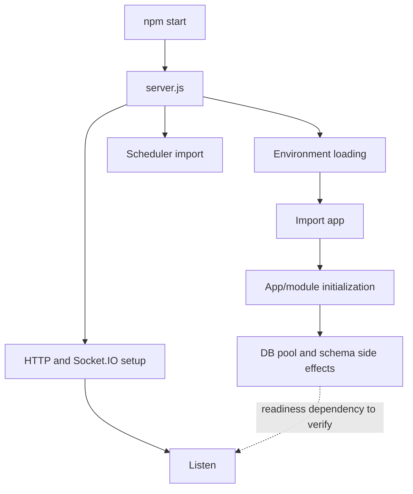

# Phase 2 — Backend Bootstrap and Application Lifecycle

**Status:** Planned / not yet analyzed.  
**Source scope:** `Syncaura-backend/package.json`, `server.js`, `src/app.js`, `src/config/db.js`, `src/config/init.sql`, `run-init.js`, `index.js`, `Dockerfile`, environment templates, and `.github/workflows/backend-ci.yml`.

> This is a scoped investigation checklist, not a completed audit. Fill in findings only after tracing the relevant code and, where possible, running reproducible checks.

## Questions this phase must answer

1. What exact sequence happens during `npm start` and `npm run dev`?
2. Are dotenv variables loaded before all modules that read them?
3. Does the server begin listening before PostgreSQL is actually ready?
4. Are schema changes performed at runtime, via `npm run migrate`, or both?
5. Do `DATABASE_URL` and the discrete `DB_*` variables target the same database?
6. What happens if PostgreSQL is down or a migration fails?
7. Which configuration/environment template is canonical?
8. What do `index.js` and `outlook-sync/server.js` represent operationally?
9. What does the Dockerfile actually copy and start?
10. Does CI test server startup only, or does it validate API/database correctness?

## Startup diagram to complete

## File review checklist

### `package.json` and lockfile
- Record Node version assumptions and all scripts.
- Explain the `main` field versus explicit npm script behavior.
- Map dependency packages to real import/call sites; identify unused or duplicated packages.
- Verify the test script and dependency-lock reproducibility.

### `server.js`
- Record statement/import evaluation order.
- Understand when app and scheduler modules initialize.
- Explain HTTP server and Socket.IO construction.
- Assess listen error behavior, logging, and graceful shutdown.

### `src/app.js`
- Record middleware order and why order matters.
- Trace CORS allowlist and `CLIENT_URL` behavior.
- Record payload-size limits, cookies, static uploads, route mounts, health endpoint, frontend fallback, 404 and error middleware.
- Distinguish liveness from readiness.

### `src/config/db.js`
- Explain Pool creation, connection string, SSL behavior and idle-client errors.
- Trace the startup query and schema alteration batch.
- Determine whether a migration failure prevents readiness.
- Evaluate migration concurrency and schema-versioning risk.
- Verify error handling and pool shutdown.

### `src/config/init.sql` and `run-init.js`
- Build a repeatable local setup sequence.
- Compare environment-variable sources used by initialization and normal runtime.
- Check transaction behavior and whether a failed SQL statement can leave partial initialization.
- Verify foreign keys, constraints, defaults and initial migration idempotency.

### Environment templates
- Create a table of environment keys, owning module, required/optional, default behavior, and validation.
- Never record actual secret values. Report names and presence only.
- Consolidate template discrepancy only as a recommendation unless implementation changes are explicitly requested.

### Docker and CI
- Explain image build layers, Node version, dependency installation and start command.
- Inspect the CI timeout outcome and what it can miss.
- Propose a health-polling smoke test and deterministic unit/integration tests where appropriate.

## Finding template

For each issue, record:
- **ID / severity**
- **Evidence and exact file/function**
- **Reproduction or validation**
- **Impact**
- **Root cause**
- **Minimal recommendation**
- **Verification plan**
- **Interview explanation**, without overstating personal involvement

## Potential improvements to evaluate (not pre-approved)

- Validate required environment variables at startup with safe, actionable errors.
- Avoid accepting traffic until PostgreSQL is ready.
- Move schema evolution into a controlled migration command rather than implicit application-import side effects, if current behavior confirms that risk.
- Ensure one canonical database configuration path.
- Implement graceful shutdown for HTTP, Socket.IO, scheduler and PostgreSQL pool.
- Replace timeout-only CI logic with a readiness check and deterministic tests.

The phase report should state which recommendations are warranted by the observed implementation rather than assuming all are necessary.
